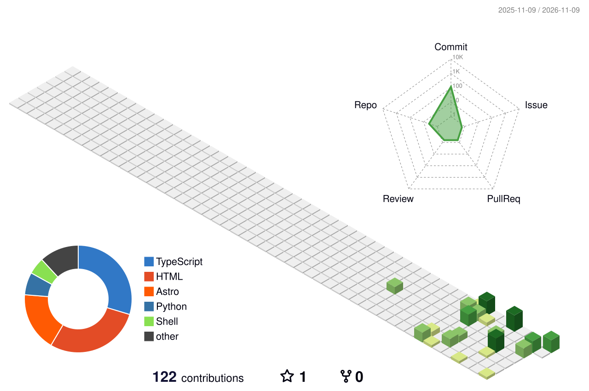

<h1 align="center">你好，我是慕容长恭 </h1>

  <b>RoboMaster 天钺 Solaris 战队建立者之一 · 视觉组组长</b> 
  东南大学成贤学院 · 计算机系 · DJI 拥护者

  
  

  

---

### 关于我

- 🎓 东南大学成贤学院计算机系学生，从电气工程转入计算机，投身 RoboMaster 竞赛
- 🤖 天钺（Solaris）机甲大师战队建立者之一，负责视觉组，主攻机器人视觉与嵌入式
- 🔭 关注方向：目标检测与自瞄、ROS2、Jetson 边缘部署、STM32 下位机
- 🌱 项目驱动式学习中：Python / OpenCV / C++ / ROS2 / STM32
- 💬 喜欢把踩过的坑整理成博客笔记，也维护战队开源资源目录

### 技术栈

  
  
  
  
  
  

  
  
  
  
  

### GitHub 数据

|  |  |
|---|---|

### 3D 贡献图

<picture>
  <source media="(prefers-color-scheme: dark)" srcset="profile-3d-contrib/profile-night-green.svg">
  
</picture>

### 我的项目

**个人项目**
- [HortonWen.github.io](https://github.com/HortonWen/HortonWen.github.io) — 基于 Astro / Shirone 的个人技术博客
- [cxxy-campus-wifi](https://github.com/HortonWen/cxxy-campus-wifi) — 校园网自动登录工具（PowerShell）
- [seu-cxxy-campus-skill](https://github.com/HortonWen/seu-cxxy-campus-skill) — 校园系统相关技能脚本（Python）

**Solaris 战队组织**
- [rm-open-source-leaderboard](https://github.com/SEU-CX-RM-Solaris/rm-open-source-leaderboard) — 机甲大师开源资源目录
- [solaris-rm](https://github.com/SEU-CX-RM-Solaris/solaris-rm) — 战队主页
- [solaris-fetch](https://github.com/SEU-CX-RM-Solaris/solaris-fetch) — 终端 TrueColor 横幅合集
- [solaris-blog-rm-seu-cxxy](https://github.com/SEU-CX-RM-Solaris/solaris-blog-rm-seu-cxxy) — 战队技术博客

---

  <i>更多内容见我的博客 ➜ <a href="https://hortonwen.github.io/">hortonwen.github.io</a></i>

